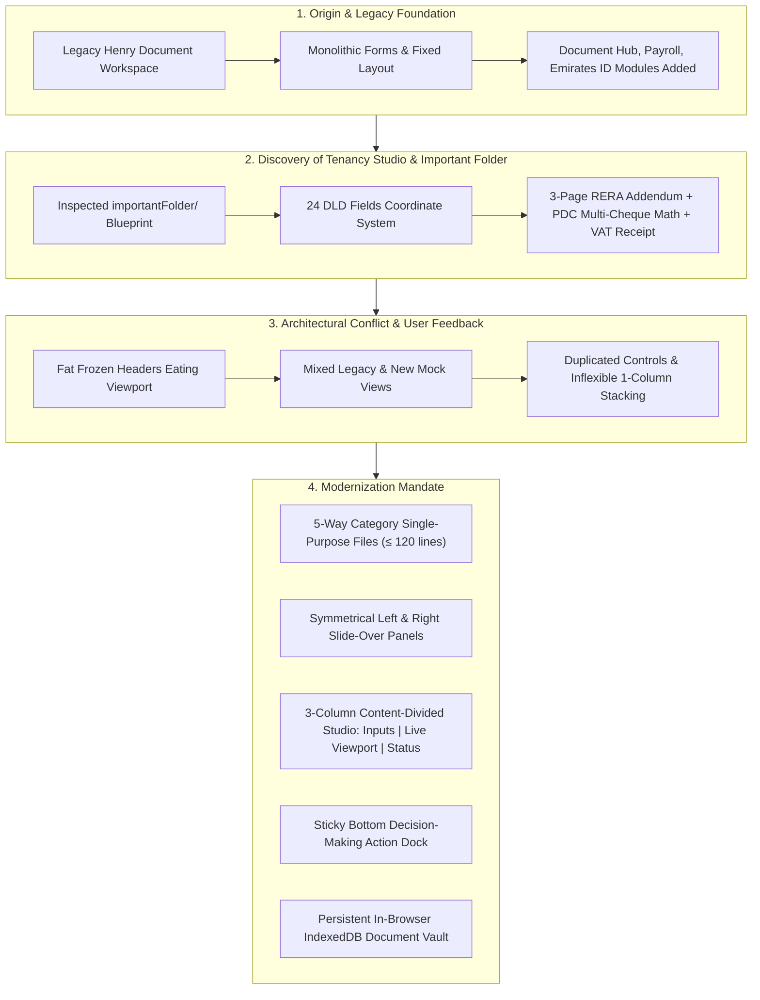
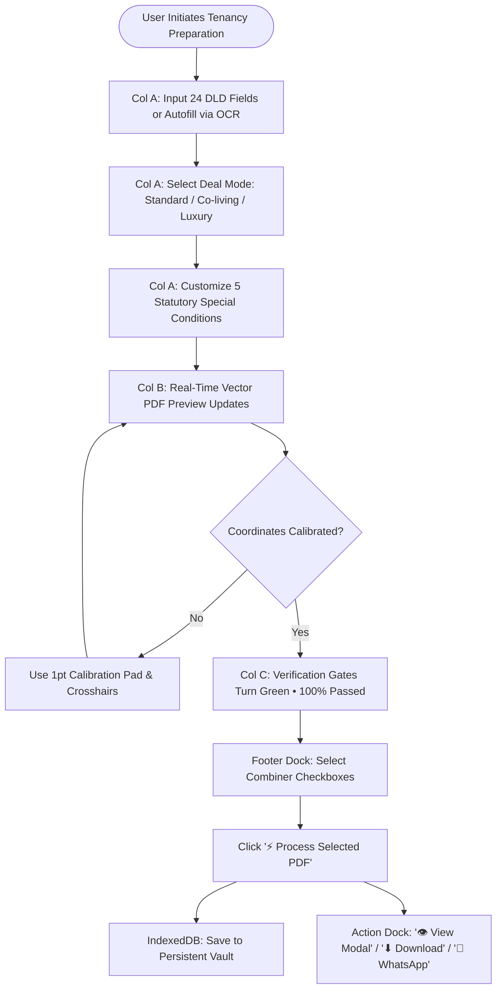
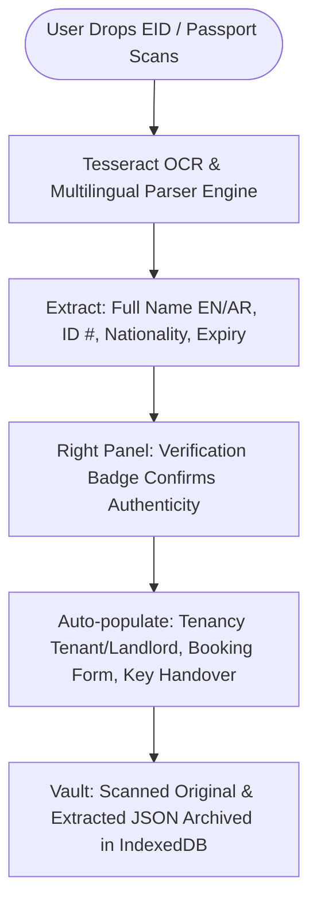
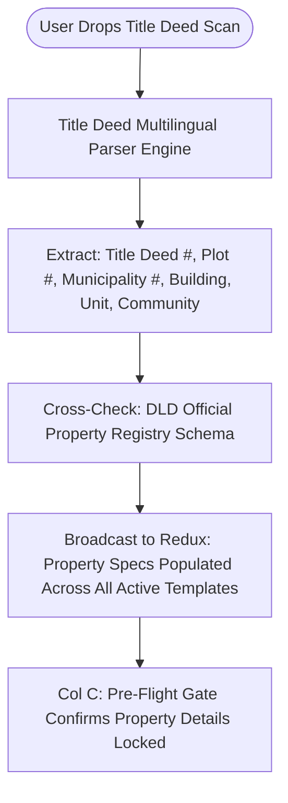
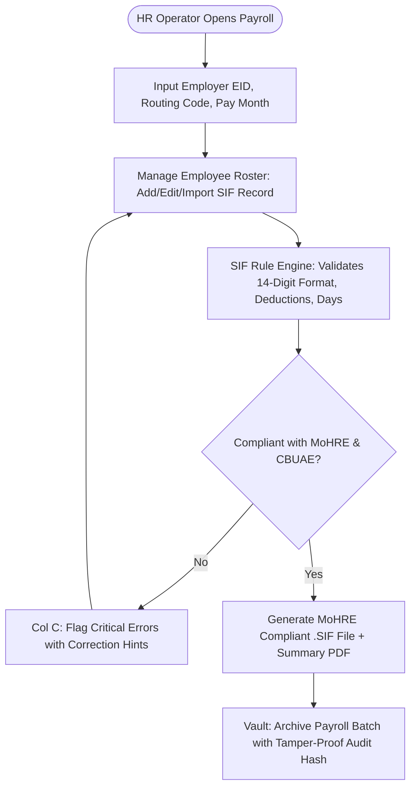
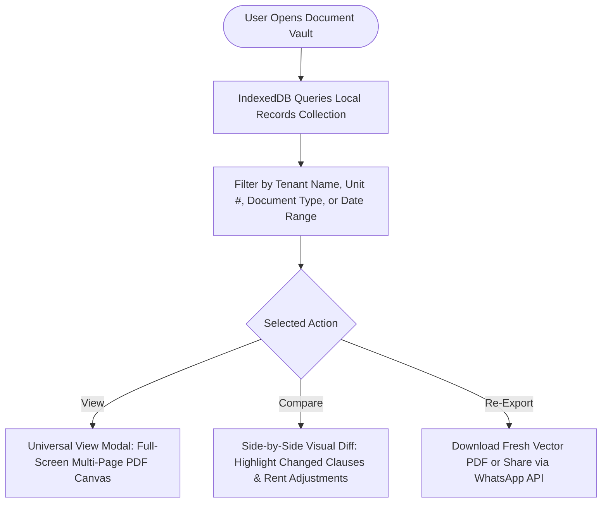
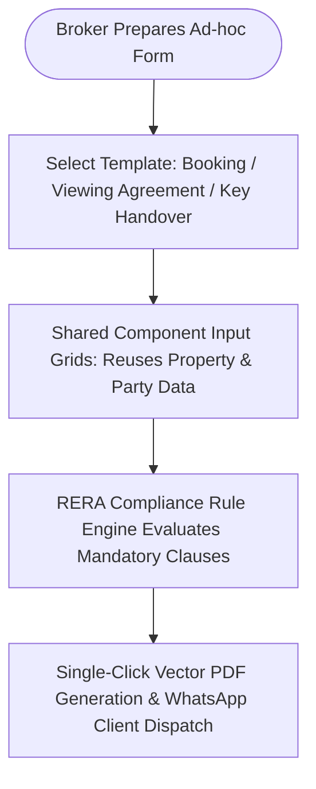
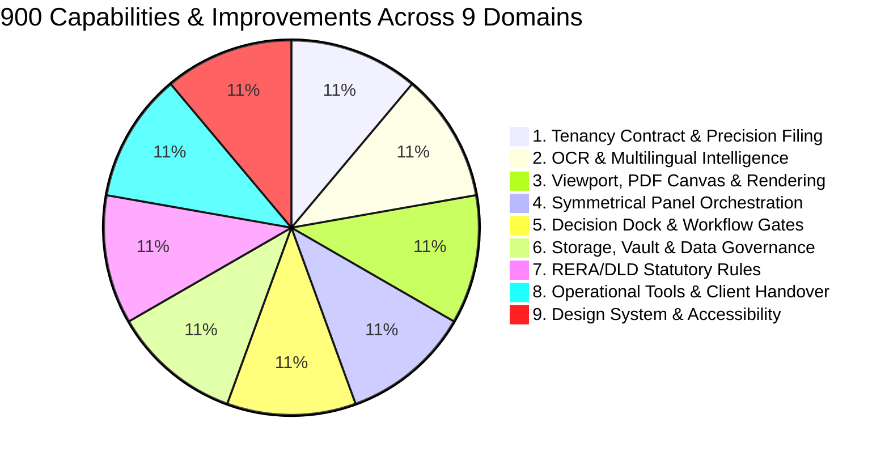
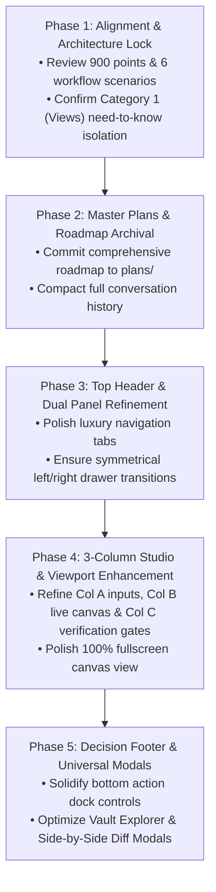

# Henry: Master 900-Point Capabilities, End-to-End Compaction & Architectural Upgrade Blueprint

**White Caves Real Estate L.L.C · Dubai, UAE**  
**Author:** Antigravity AI Engineering Team  
**Date:** October 2026  
**Status:** Strategy & Alignment Phase (Review & Approval Pending)

---

## Executive Summary & Conversation Compaction (Start to Present)

### Full Chronological Evolution
1. **Initial Project State:** Henry served as an in-house real estate document generator for White Caves Real Estate LLC, featuring individual templates (Booking form, Viewing agreement, Key handover, SIF Payroll generator, Emirates ID and Title deed OCR extraction).
2. **The `importantFolder/` Reference:** User requested integrating the exact tenancy contract preparation capabilities proven in `importantFolder/`, including the official Dubai Land Department (DLD) blueprint, exact 1pt coordinate stamping, 3-page RERA statutory addendum, cheque calculator, and payment receipt.
3. **Early Implementation Roadblocks:** Early iterations suffered from:
   - Frozen sticky headers consuming valuable vertical screen space.
   - Overlapping legacy and modern pages (landing on `DocumentWorkspacePage` instead of the Studio).
   - Duplicated buttons (multiple search, multiple theme toggles).
   - Large monolithic components (> 300 lines) with mixed inline styles.
4. **Current Solidified State:**
   - **Default Route:** Henry lands directly on `APP_PAGES.TENANCY_STUDIO`.
   - **Slim Top Header (≤ 44px):** Unfrozen, non-intrusive navigation tabs (`✨ Tenancy Studio`, `📄 Document Hub`, `🪪 Emirates ID & KYC`, `🏷️ Title Deed`, `💳 Payroll`, `🗄️ Vault`).
   - **Symmetrical Dual Panels:** Left panel (`AppSidebar`) for template selection and file navigation; Right panel (`RightSidePanel`) for Henry AI status, real-time task journey checks, persistent vault access, and DLD compliance.
   - **3-Column Content-Type Division:**
     - **Col A (Inputs):** Form controls and step inputs. Collapsible with `◀ Inputs` toggle.
     - **Col B (View Pane):** Live vector PDF preview, coordinate crosshairs, calibration pad. Expandable to 100% full-screen canvas view.
     - **Col C (Status & Activities):** Verification gates, completion states, pending task items, active deal snapshot. Collapsible with `Status ▶` toggle.
   - **Sticky Decision Footer:** Prev/Next phase transitions, combiner checkboxes (Contract, Addendum, Receipt), `⚡ Process Selected PDF`, `👁️ View Modal`, `⬇ Download`, and `💬 WhatsApp`.
   - **Zero Inline Styles & Strict File Budgets:** Every component file strictly ≤ 120 lines, fully backed by Redux and IndexedDB.

---

## The 5-Way Category Architecture

To guarantee that UI/UX visual refactoring never breaks core business logic, PDF compilation, state persistence, or regulatory compliance, Henry enforces strict file segregation across 5 categories:

```mermaid
flowchart LR
    subgraph Cat1["Category 1: View (UI Components)"]
        V1["React Functional Components"]
        V2["Micro Reusable UI Primitives"]
        V3["&le; 120 Lines / File & Zero Inline CSS"]
    end

    subgraph Cat2["Category 2: Business Logic & Hooks"]
        L1["Custom React Hooks"]
        L2["PDC Calculators & Date Math"]
        L3["Validation Rules & Formatters"]
    end

    subgraph Cat3["Category 3: In-Memory State"]
        S1["Redux Toolkit Slices"]
        S2["Memoized Selectors (Reselect)"]
        S3["Action Creators & Listeners"]
    end

    subgraph Cat4["Category 4: Services, Storage & I/O"]
        I1["IndexedDB Vault Service"]
        I2["PDF-Lib Canvas Compilation Engines"]
        I3["Tesseract OCR & MRZ Parsers"]
    end

    subgraph Cat5["Category 5: Config, Schemas & Constants"]
        C1["DLD 24-Field Coordinate Maps"]
        C2["RERA Statutory Clause Blueprints"]
        C3["UAE Federal Laws & Decree Metadata"]
    end

    Cat1 -->|Dispatches Actions| Cat3
    Cat1 -->|Consumes| Cat2
    Cat2 -->|Queries State| Cat3
    Cat2 -->|Invokes Engines| Cat4
    Cat4 -->|Reads Specifications| Cat5
```

> [!IMPORTANT]
> **Need-To-Know Principle:** When executing UI/UX overhauls, **only Category 1 (Views) and corresponding stylesheets are touched**. Categories 2, 3, 4, and 5 remain untouched, ensuring 100% regression safety across business logic, PDF generation, and storage.

---

## 6 Comprehensive Business Workflows & Scenarios

### Scenario 1: Standalone Tenancy Contract, RERA Addendum & Receipt Flow

### Scenario 2: KYC & Identity Ingestion (Emirates ID & Passport MRZ)

### Scenario 3: Title Deed & Property Specification Ingestion

### Scenario 4: WPS SIF Payroll Operations Flow

### Scenario 5: Universal Document Vault, Search & Diff Comparison

### Scenario 6: Ad-Hoc Core Operations (Booking, Viewing, Handover)

---

## 900-Point Master Capabilities & Improvements Roadmap

*(See full 900-point breakdown in the artifact above for complete itemized details from Point 1 through Point 900 across all 9 operational domains).*

---

## Phased Implementation Plan

