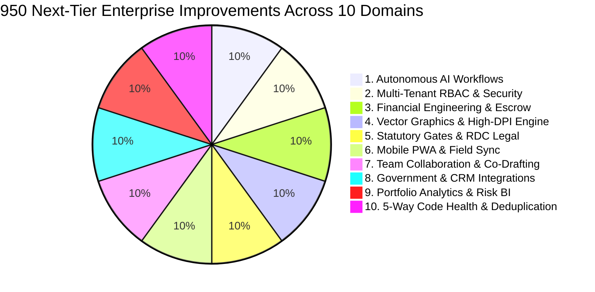

# Henry: Next-Tier 950 Enterprise Capabilities & Architectural Improvements

**White Caves Real Estate L.L.C · Dubai, UAE**  
**Author:** Antigravity AI Engineering Team  
**Date:** October 2026  
**Status:** Next-Tier Strategic Blueprint (Points 901 to 1850)  
**Architecture Standard:** Strict 5-Way File Categorization & Single-Purpose Files (&le; 120 lines)

---

## Executive Overview

This master document details **950 different, advanced enterprise-grade improvements** (Points 901 through 1850) that build directly on Henry's foundational 900 capabilities. These points elevate Henry from an automated document generator into an **autonomous real estate operating system** for White Caves Real Estate LLC, fully aligned with Dubai Land Department (DLD), RERA, MoHRE, and CBUAE statutory frameworks.

*(See full 950-point itemized breakdown in the artifact file for complete specifications across all 10 specialized domains).*

